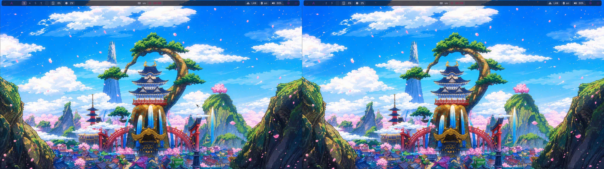
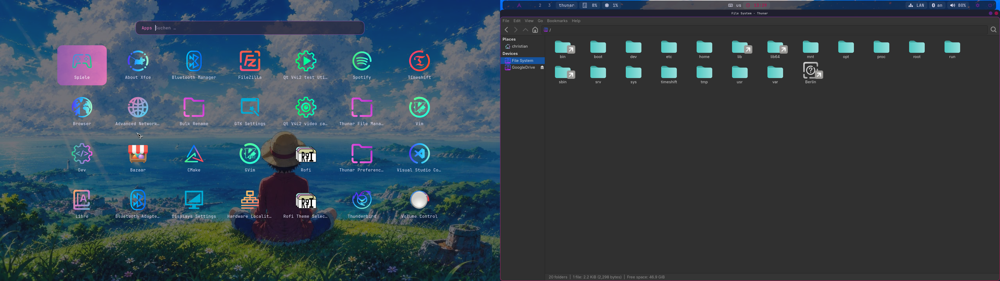

# ChristianOS

Mein persönliches Arch-Linux-Setup mit **Hyprland** – lila-pinkes Design, ein
App-Menü mit Ordnern wie auf dem Handy und ein paar eigene Helfer in der Waybar.

> Das ist keine eigene Distribution, sondern eine Sammlung von Konfigurationsdateien
> (Dotfiles) für ein bestehendes Arch Linux.





## Was drin ist

| Bereich | Datei(en) | Was es macht |
|---|---|---|
| Fenstermanager | `config/hypr/hyprland.lua` | Hyprland mit Lua-Config, Tastenkürzel, Animationen, Fensterregeln |
| Sperrbildschirm | `config/hypr/hyprlock.conf` | Uhr, Begrüßung und Passwortfeld im ChristianOS-Look |
| Leiste | `config/waybar/` | Waybar mit Einstellungsmenü, Power-Menü und Netzwerkfenster |
| App-Menü | `config/rofi/ordner.sh` | Startbildschirm mit Ordnern: Apps sortieren, verschieben, suchen |
| Terminal | `config/kitty/kitty.conf` | kitty im passenden Farbschema |
| Zweiter Bildschirm | `scripts/surface-monitor` | Tablet oder zweiten Laptop per VNC als erweiterten Monitor nutzen |

## Benötigte Pakete

```bash
sudo pacman -S --needed hyprland hyprlock kitty thunar waybar swaync rofi wofi \
    grim slurp wl-clipboard libnotify brightnessctl playerctl \
    wireplumber pavucontrol blueman network-manager-applet \
    ttf-jetbrains-mono-nerd
```

Hintergrundbilder setzt ChristianOS mit **awww** (früher `swww`), aus dem AUR:

```bash
yay -S awww
```

Optional:

- `wayvnc` – für `surface-monitor`
- Das Hyprland-Plugin **hyprbars** (über `hyprpm`) für Fenster-Titelleisten mit Knöpfen.
  Ohne Plugin wird dieser Teil der Config einfach übersprungen.

## Installation

> **Achtung:** Das überschreibt deine bestehenden Configs für Hyprland, Waybar, rofi
> und kitty. `install.sh` legt vorher automatisch eine Sicherung an.

```bash
git clone https://github.com/zotaxen/christianos.git ~/christianos
cd ~/christianos
./install.sh
```

Danach aus- und wieder einloggen bzw. Hyprland neu starten.

## Anpassen

- **Monitore:** Im Abschnitt `MONITORS` in `hyprland.lua` stehen meine Bildschirme
  (`DP-2` mit 240 Hz, `DP-3` mit 144 Hz). Deine Namen findest du mit `hyprctl monitors`.
  `monitors.conf` und `workspaces.conf` sind Beispiele für ein Desktop-Setup mit zwei Bildschirmen.
- **Hintergrundbild:** Lege eigene Bilder in `~/Pictures/wallpaper/`. Beim Start wird das
  Bild verwendet, dessen Pfad in `~/.config/christianos/wallpaper` steht.
  Die Bilder aus meinen Screenshots sind **nicht** enthalten (Urheberrecht).
- **Menü-Hintergrund:** In `config/rofi/christianos.rasi` bei `background-image` ein eigenes Bild eintragen.
- **Terminal-Hintergrund:** In `config/kitty/kitty.conf` die Zeile `background_image` einkommentieren und den Pfad anpassen.
- **Mauszeiger:** In `hyprland.lua` ist das Zeigerthema `Skyrim` eingestellt. Ersetze es durch ein installiertes Thema.

## Tastenkürzel

`Super` ist die Windows-Taste.

| Kürzel | Aktion |
|---|---|
| `Super + Space` | App-Menü mit Ordnern |
| `Super + A` | App-Suche |
| `Super + Q` | Terminal (kitty) |
| `Super + E` | Dateimanager (Thunar) |
| `Super + R` | Programmstarter (wofi) |
| `Super + C` | Fenster schließen |
| `Super + V` | Fenster schwebend / angedockt |
| `Super + L` | Bildschirm sperren |
| `Super + B` | Waybar ein- und ausblenden |
| `Super + I` | Einstellungsmenü |
| `Super + M` | Zweiten Bildschirm per VNC an/aus (`surface-monitor`) |
| `Super + H` | Fenster verstecken (Spezial-Arbeitsbereich) |
| `Super + Shift + H` | Versteckte Fenster anzeigen |
| `Super + S` / `Super + Shift + S` | Scratchpad anzeigen / Fenster hineinschieben |
| `Super + Tab` | Tastaturlayout wechseln (US / DE) |
| `Super + 1 … 0` | Arbeitsbereich wechseln |
| `Super + Shift + 1 … 0` | Fenster auf Arbeitsbereich verschieben |
| `Super + Pfeiltasten` | Fokus wechseln |
| `Super + linke / rechte Maustaste` | Fenster verschieben / Größe ändern |
| `Druck` | Bereich als Screenshot in die Zwischenablage |
| `Shift + Druck` | Ganzen Bildschirm speichern |
| `Super + Druck` | Bereich als Datei speichern |
| 3 Finger wischen | Arbeitsbereich wechseln (Touchpad) |

## Hinweis zu `surface-monitor`

Das Skript gibt einen virtuellen Bildschirm **ohne Passwort** im Netzwerk frei.
Nutze es nur im eigenen WLAN oder Handy-Hotspot, nicht in öffentlichen Netzen.
